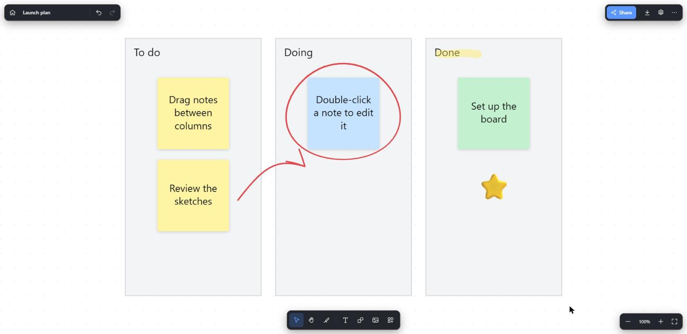
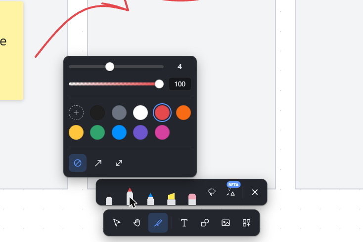
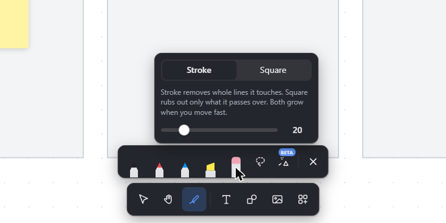
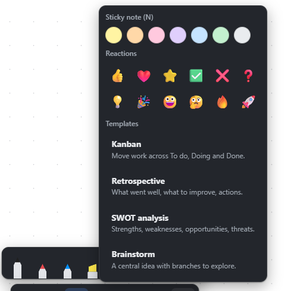
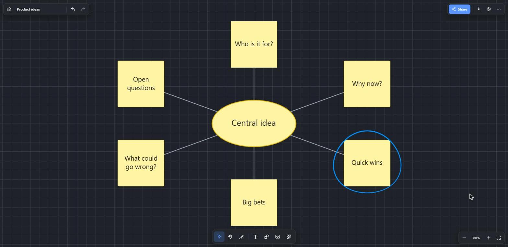
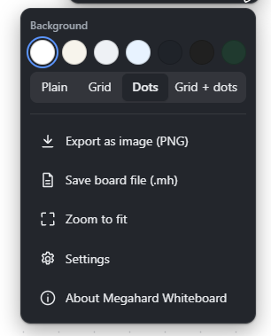
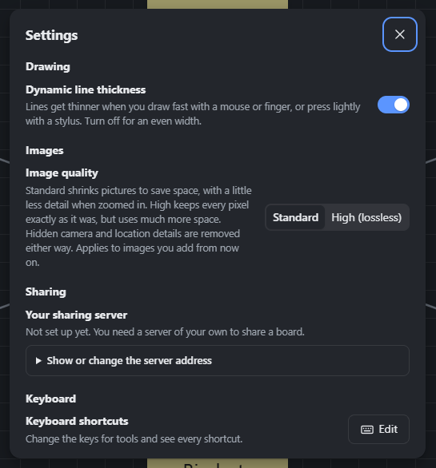
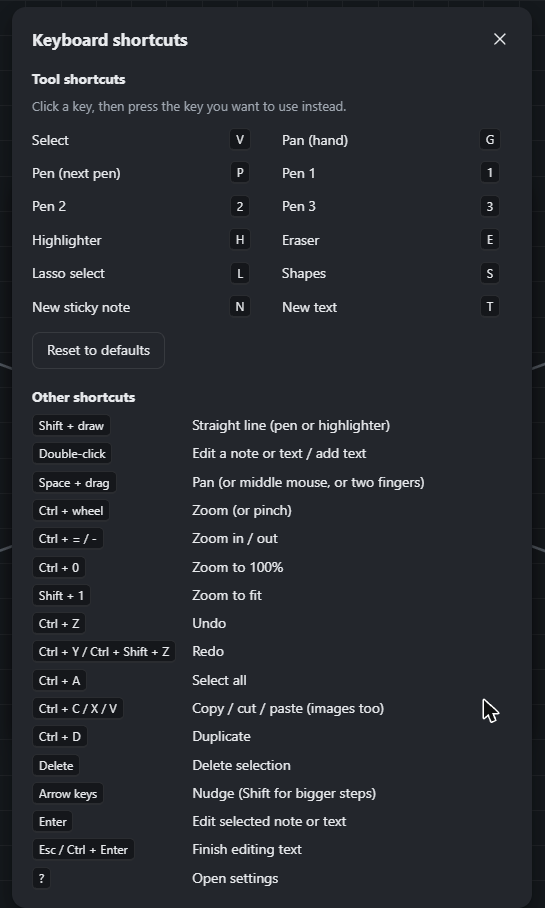
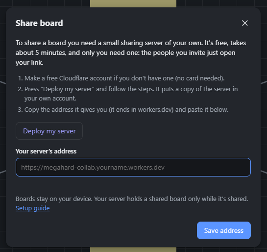
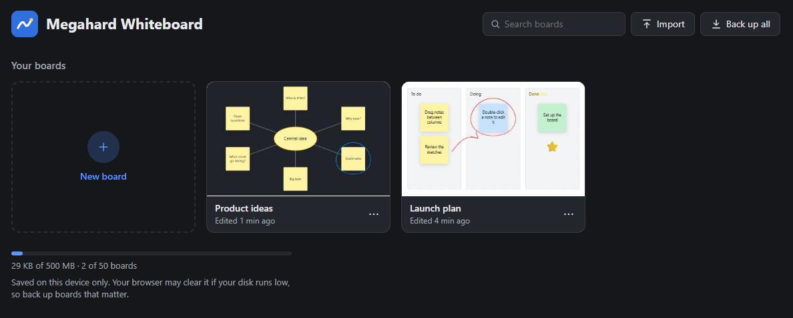

# Megahard Whiteboard

A whiteboard that keeps your boards **on your own device**. There are no accounts and no tracking, it works offline, and you can share a board to draw on it live with others.

**[Use Megahard Whiteboard in your browser →](https://ardzeyftw.github.io/Megahard-Whiteboard/app/)** · [Website](https://ardzeyftw.github.io/Megahard-Whiteboard/)



It runs in your browser, and nothing you draw is uploaded unless you share a board. To use it like a desktop app, choose **Install** in your browser's address bar (Chrome and Edge) and it gets its own window, a Start menu entry and offline support.

Why the name? It's the opposite of micro and soft.

Megahard Whiteboard is an independent, clean-room project inspired by the everyday workflow of tools like Microsoft Whiteboard. The name is a parody. The project contains no Microsoft code, assets or file formats, and it is not affiliated with or endorsed by Microsoft.

## Features

### Inking



- A bottom dock with an ink tray that pops up while drawing: three pens, a highlighter and an eraser. Click a pen again for thickness and opacity sliders, two rows of colors plus a custom color picker, and line ends. Pressure-sensitive with a stylus, smoothed with a mouse or finger.
- Pens can draw arrows at the end or at both ends.
- Highlighter with its own thickness, opacity and color.
- Hold Shift while drawing for a perfectly straight line (snaps to horizontal, vertical and 45°).
- Lasso select.
- **Ink to shape** (beta): tidies rough lines, rectangles, ellipses, triangles and diamonds into clean shapes. It's new and doesn't always get it right yet.



- Two erasers. **Stroke** removes whole lines it touches. **Square** rubs out only the ink it passes over. Both grow when you move fast, and you choose the size. The eraser end of a stylus also works.

### Create



- Sticky notes in seven colors. The text automatically shrinks to fit.
- Text boxes.
- Shapes: rectangle, ellipse, triangle, diamond, line and arrow. Hold Shift for perfect squares and circles, or to snap line angles.
- Images: use the Import button in the toolbar, paste, or drag and drop. Very large photos are downscaled automatically.
- PDFs: use the same Import button, or drag in or paste a PDF to scribble on top of it. Choose which pages to bring in (for example `1-3, 5`), turn any page that came in sideways, and stack the pages top to bottom (the default), left to right, or in a grid with the number of columns you choose. Each page becomes an image on the board, drawn at the image quality set in Settings.
- Templates: Kanban, Retrospective, SWOT and Brainstorm.
- Reactions (emoji stamps).



### Board



- Infinite canvas with pan and zoom: the hand tool, wheel, trackpad, pinch, Space+drag or the middle mouse button. Zoom in and out from the corner controls, or **Zoom to fit** to see everything.
- Select, move, resize, duplicate, recolor, fill and reorder items. The selection bar floats above whatever you pick. Arrow keys nudge it (Shift for bigger steps). Hold Alt while resizing to scale from the center.
- Undo and redo, copy, cut and paste (also between boards and browser tabs).
- Background color (light or dark, including Graphite) plus a plain, grid, dotted or grid-with-dots pattern. New boards start with whichever you picked last.
- Export as PNG, or save the board as a `.mh` file, from the menu in the top right.
- Rename the board by clicking its name.

### Settings and shortcuts

Open settings with the gear icon, or press `?`.



- **Dynamic line thickness**: lines get thinner when you draw fast, or press lightly with a stylus. Turn it off for an even width.
- **Image quality**: *Standard* shrinks pictures to save space. *High (lossless)* keeps every pixel but uses much more space. Either way, hidden camera and location details (EXIF and similar metadata) are removed from images you add.
- **Your sharing server**: show or change the address of the server you share boards through.
- **Keyboard shortcuts**: change the key for any tool, and see every shortcut in one list.



### Share live



- Share a board with an edit link or a view-only link. Everyone editing sees each other's cursors, selections and strokes as they're drawn. You choose how many people can edit (up to 10, you included, each with their own colour). Anyone past that joins as a viewer, and up to 10 viewers can watch.
- Viewers follow along. They start out looking at whatever part of the board the owner is looking at, however big or small their screen is, and glide there instead of jumping. The eye button follows the owner's view, or matches their zoom again. Zooming keeps following the owner's place at the viewer's own zoom, and moving around or picking something lets go.
- Viewers get a board of their own beside the shared one (side by side, or top and bottom): write along, and copy things from the shared board into theirs. Their board is a normal board kept on their device, with the same full set of tools.
- People joining need no account: they enter a name (or take a suggested one, like "Blue Otter").
- If you leave, others can keep going for an hour. Their changes come back to your board the next time you open the app.

The picture above is what you see the first time you press **Share**, before a server is set up. See [Sharing and the collaboration server](#sharing-and-the-collaboration-server) below.

### Your data



- Boards autosave to the browser's IndexedDB on your device.
- The home screen shows every board as a thumbnail. Search by name, rename, duplicate or delete a board from the **...** menu on its card, and see how much of your storage is used.
- Each board can be saved as a `.mh` file (plain JSON), and "Back up all" saves every board in one file. Both can be imported again on any device.
- It can be installed as an app and keeps working offline.

## Getting started

You need [Node.js](https://nodejs.org) 20 or newer.

```bash
npm install
npm start          # start the app and open it in your browser
npm run dev        # same, without opening the browser (http://localhost:4173)
npm run build      # type-check and build static files into dist/
npm run preview    # serve the production build
```

The app has to be served over http(s). Double-clicking `index.html` won't work, because browsers block apps like this from loading their files from `file://`.

Your boards are tied to the address you use (`http://localhost:4173` here), so stick to one address. Boards created at another address or port are stored separately.

`dist/` is a static site, so you can host it anywhere: GitHub Pages, Netlify, any web server, or a folder on a local server. Offline support and the install prompt need HTTPS or `localhost`.

The public website is built and published to GitHub Pages automatically on every push to `main` (see [.github/workflows/pages.yml](.github/workflows/pages.yml)). The landing page in [site/](site/) goes at the root and the app at `/app/`. Boards made on the public site and boards made on `localhost` are stored separately; move them across with **Back up all** and **Import**.

## Sharing and the collaboration server

Boards stay on their owner's device. When you share one, a small server holds a copy so others can join. **The server is yours:** each person who shares runs their own on Cloudflare's free plan (code in [server/](server/)), so nobody else's account holds your boards and there is no central server to run out of free limits. It keeps the copy while you're there and for an hour after you leave, then up to 7 days for your app to collect everyone's changes, and then deletes it. Shared boards aren't end-to-end encrypted. The design is in [docs/collaboration-plan.md](docs/collaboration-plan.md).

Setting up your server takes about 5 minutes, once: press **Share**, then **Deploy my server**, and paste the address Cloudflare gives you. People you invite need nothing: the link says which server holds the board. See [setting up your own sharing server](docs/self-hosting.md).

## Where your boards are stored

| What | Where |
| --- | --- |
| Boards | IndexedDB database `megahard-whiteboard` in the browser profile you use |
| Your setup: pens, highlighter, last tool, shortcuts, settings, and the background new boards start with | `localStorage` (shared by all boards) |
| Backups and transfers | `.mh` files you save yourself |

Boards are packed to stay small: pen strokes are stored as compact 32-bit numbers (pressure is left out when it never changes), and images are stored as binary data instead of base64 text, with identical images kept once.

To stay well inside what browsers reliably keep, the browser version has limits, set in [src/limits.ts](src/limits.ts): 50 boards, 500 MB in total (less if the browser offers less), and 50 MB per board. The home screen shows how much is used, warns at 80%, and a pop-up explains what to do when a limit is reached.

Browser storage belongs to one browser profile on one device. If you clear site data, or the browser frees space when the disk is full, your boards can be lost. Megahard Whiteboard asks the browser for persistent storage, and the home screen shows whether it was granted. Use **Back up all** regularly for boards that matter.

If you open the same board in two tabs at once, the last tab to save wins.

## What it doesn't do (yet)

- Importing boards from Microsoft Whiteboard. Its format isn't documented. To keep an old board, export it from Microsoft Whiteboard as an image and insert that image here.
- Ruler, PDF or PowerPoint import, and comments.

## File format

A `.mh` file is JSON:

```json
{
  "format": "megahard-whiteboard",
  "version": 1,
  "board": {
    "name": "My board",
    "background": { "color": "#ffffff", "pattern": "dots" },
    "elements": [
      { "type": "note", "id": "…", "x": 0, "y": 0, "w": 200, "h": 200, "color": "#fff4a3", "text": "Hi" }
    ],
    "assets": { "<asset id>": "data:image/png;base64,…" }
  }
}
```

Element types are `stroke`, `shape`, `line`, `note`, `text` and `image`; see [src/types.ts](src/types.ts). Imported files are validated, and only `data:image/…` URLs are accepted for images.

## Project layout

```
src/
  main.ts            routing between the home screen and a board
  types.ts           the document model
  editor/editor.ts   canvas input, tools, selection, undo, clipboard, autosave
  editor/history.ts  snapshot undo/redo
  render.ts          canvas drawing, PNG export, thumbnails
  geometry.ts        bounds, hit testing, transforms
  ink.ts             stroke outlines (perfect-freehand) and ink-to-shape recognition
  text.ts            text wrapping and sticky-note font fitting
  db.ts              IndexedDB storage
  io.ts              .mh files, backups, saving
  prefs.ts           your setup, shared across boards
  model.ts           element factories and validation of imported data
  templates.ts       built-in templates
  ui/                toolbars, menus, home screen
public/              PWA manifest, service worker, icon
site/                landing page for the public website
```

The only runtime dependency is [perfect-freehand](https://github.com/steveruizok/perfect-freehand) (MIT), which draws the pressure-sensitive ink.

## Contributing

Issues and pull requests are welcome. Please keep the app local-first: no network calls, analytics or required accounts. Run `npm run build` before opening a PR; it includes the type check. By sending a pull request you agree that your contribution is licensed under the same terms as the rest of the project (see below).

## License

Megahard Whiteboard is source-available, not open source. It is licensed under the [PolyForm Noncommercial License 1.0.0](LICENSE). You can use, read, change and share it for any noncommercial purpose, including personal use, hobby projects, education and charities. You can't use it commercially, and that includes selling it. If you want to use it commercially, ask first.

The libraries it depends on keep their own licenses.
